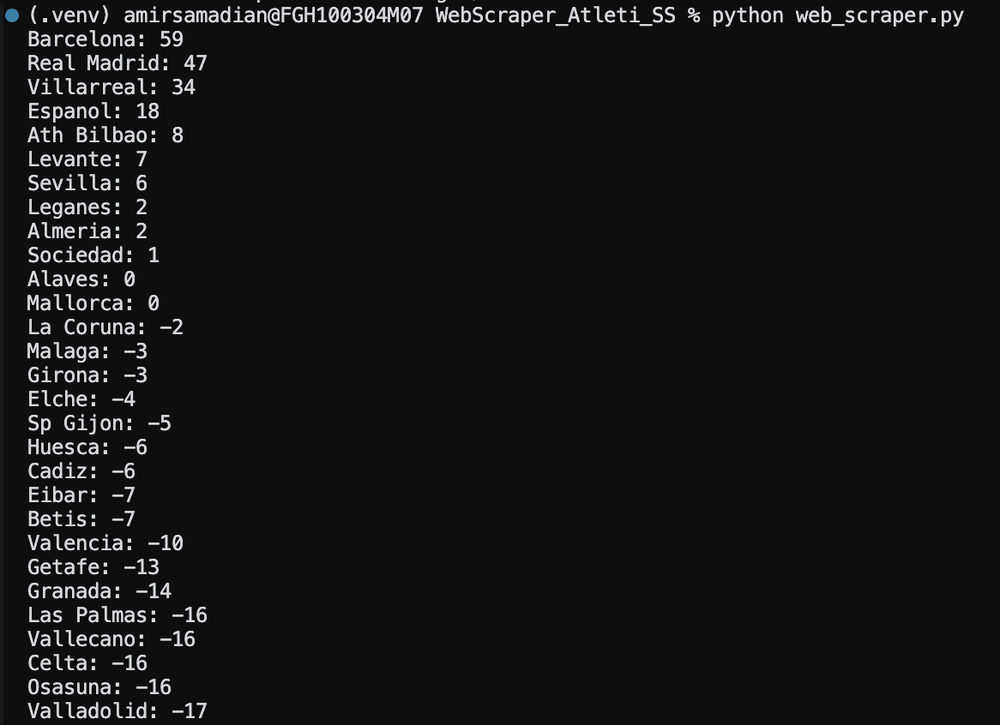

# Atlético Madrid Rivalry Analyzer

This is a Python web scraper that analyzes Atlético Madrid's results against other La Liga teams over 10 seasons (2015–16 through 2024–25).

It downloads match data from [Football-Data.co.uk](https://www.football-data.co.uk/spainm.php), calculates Atlético's record against each opponent, and ranks them using a difficulty score I came up with.

## How to Run

Install the required library:

```bash
pip install requests
```

Run the program:

```bash
python3 web_scraper.py
```

## Difficulty Score

I calculated the difficulty score using:

```text
Difficulty = (Losses × 3) + (Draws × 2) + Goals Conceded − Goals Scored
```

The idea is to account for the points Atlético lost against each opponent, as well as goal difference. A higher score means a more difficult opponent.

## Functional Programming and Concurrency

I used `filter()` to select Atlético's matches and `map()` to convert them into dictionaries containing only the information I needed. Since these functions use iterators, I don't need to store another list of all the matches in memory. This can save memory, although it doesn't necessarily improve execution speed.

I also used `concurrent.futures.ThreadPoolExecutor` to download multiple seasons at the same time instead of waiting for each download to finish before starting the next one. Since downloading data involves waiting for network responses, this can make the program faster.

## Results

The three most difficult opponents according to my algorithm were:

1. Barcelona: 59
2. Real Madrid: 47
3. Villarreal: 34

These scores are cumulative, so teams that played Atlético more often may have higher scores.

## Screenshot


